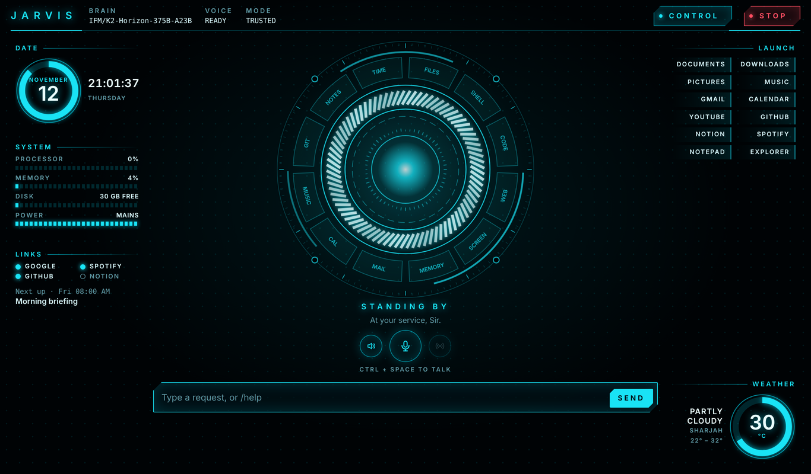

# JARVIS

A personal AI assistant for Windows that runs on your own computer and acts
on your behalf: it talks, listens, reads and writes files, searches the web,
works your apps, handles email and calendar, remembers what you tell it, and
runs reminders, all behind a permission system that decides what it may do
without asking.



This is a personal project, built and tested on one Windows 11 laptop. The
core runs on any system with Python; the window's tray icon, the shortcuts
and the screen control are Windows-only.

## Contents

- [What JARVIS can do](#what-jarvis-can-do)
- [Installing on another PC](#installing-on-another-pc)
- [Setup (Windows)](#setup-windows)
- [Choosing a brain](#choosing-a-brain)
- [Running](#running)
- [Conversations, tokens and updates](#conversations-tokens-and-updates)
- [The window](#the-window) and [the control panel](#the-control-panel)
- [JARVIS in your browser](#jarvis-in-your-browser)
- [Sight](#sight)
- [Voice](#voice)
- [Memory](#memory)
- [Reminders, scheduled tasks and the morning briefing](#reminders-scheduled-tasks-and-the-morning-briefing)
- [The tray icon and starting with Windows](#the-tray-icon-and-starting-with-windows)
- [Connecting your accounts](#connecting-your-accounts)
- [Permissions](#permissions)
- [What leaves your computer](#what-leaves-your-computer)
- [How it is organised](#how-it-is-organised)
- [Decisions you may need to understand](#decisions-you-may-need-to-understand)
- [Roadmap](#roadmap)

## What JARVIS can do

| Area | Tools |
|---|---|
| Files | read, list, search, write, move, delete |
| Documents | read PDF, Word, PowerPoint and Excel files |
| Commands and code | run PowerShell commands; write and run Python in the workspace |
| Web | search the web, read a page's text, open a page in your browser |
| Browser | in your own Chrome or Edge: list tabs, open, read, click, type, choose, scroll |
| Screen | list open windows, read what is in a window, open apps |
| Sight | look at the screen or the window in front, when asked |
| Mouse and keyboard | click, type, press key combinations |
| Memory | remember, recall, forget |
| Gmail | search, read, send, draft |
| Google Calendar | list, add and delete events |
| Spotify | play, queue, pause, skip, volume, what's playing |
| GitHub | repositories, issues, pull requests, files, notifications; open issues, comment |
| Notion | search, read, create and add to pages |
| Schedule | reminders, recurring tasks, the morning briefing |
| Weather | current conditions and a three-day forecast |

**How it reads the screen.** To work an app, JARVIS asks Windows what each window contains
(titles, buttons, menus, text fields and their contents), the same way a
screen reader does. That works well for ordinary apps and browsers. Apps
that draw their own interface, such as games, video and images, expose
little or nothing; for those there is [Sight](#sight).

**Documents.** `read_document` extracts the text of `.pdf`, `.docx`,
`.pptx` (including speaker notes) and `.xlsx` files, so you can ask for a
summary of a lecture, a quiz on a chapter, or the deadlines in a syllabus.
Long documents are read in parts. Two limits: a scanned PDF is pictures of
pages and has no text to read, and the old `.doc`, `.ppt` and `.xls`
formats are not supported (save them as the modern format first).

**Web search** uses free public search engines through the `ddgs` library,
with no account or key. They sometimes rate-limit; if a search fails, wait a
minute. Pages that need a login or build their content with scripts may
come back nearly empty; for those, JARVIS can open the page in your browser
and read it from the screen instead.

## Installing on another PC

For someone who just wants to use JARVIS, without Python or a terminal:

1. Download
   [`Install-JARVIS.bat`](https://raw.githubusercontent.com/Shadi-Atieh001/Jarvis/main/installer/Install-JARVIS.bat)
   (right-click the link and choose "Save link as").
2. Double-click it. Windows will warn that it is from an unknown publisher,
   because the file is not signed; choose "More info", then "Run anyway".
3. Wait. It installs Python and Git if they are missing, downloads JARVIS
   into a `Jarvis` folder in your user folder, sets it up, puts an icon on
   the desktop and starts it. It needs an internet connection, about 3 GB
   of disk space and 10 to 20 minutes.
4. JARVIS opens on a **setup screen** asking what to call you, your city,
   and which model to use. See [Choosing a brain](#choosing-a-brain); you
   need your own key for a hosted model, or Ollama for a free local one.

Running the installer again updates JARVIS. After that, updates are a
button under CONTROL > Settings.

Each person needs their own model key and, if they want email, calendar,
music, notes or sight, their own account connections (CONTROL > Accounts).
None of these are shared by the installer.

A new installation starts in **Careful** mode, in which JARVIS asks before
changing, deleting or running anything. Remember what this program is: an
assistant that can run commands and work the mouse and keyboard. Read
[Permissions](#permissions) before choosing a looser mode.

**Uninstalling.** Quit JARVIS from the tray icon, then delete: the `Jarvis`
folder in your user folder; the `.jarvis` folder beside it (settings,
memory, logs, downloaded models); the JARVIS shortcuts on the desktop and
in the Start menu; and, in Windows' Credential Manager under Windows
Credentials, the entries named JARVIS. Python and Git, if the installer
added them, are removed from Windows' "Installed apps" like any program.

The rest of this file describes installing by hand, which is what the
installer does for you.

## Setup (Windows)

1. Install [Python 3.14](https://www.python.org/downloads/windows/) and tick
   "Add python.exe to PATH". Python 3.13 also works. Python 3.15 runs
   everything except voice, because the speech libraries do not support it
   yet.
2. Open a terminal (PowerShell or Command Prompt) and get the code:

   ```powershell
   git clone https://github.com/Shadi-Atieh001/Jarvis.git
   cd Jarvis
   ```

3. Create a private Python environment and install JARVIS into it:

   ```powershell
   py -3.14 -m venv .venv
   .venv\Scripts\python -m pip install -e ".[desktop,memory,voice,dev]"
   ```

   The parts in brackets are optional extras: `desktop` (the window, tray
   icon and screen control), `memory` (search by meaning), `voice` (speech
   and the wake word) and `dev` (the tests). Leave any out to skip them.

4. Download and test the memory and speech models (about 280 MB, once):

   ```powershell
   .venv\Scripts\python -m jarvis setup
   ```

5. Check everything works, then start JARVIS:

   ```powershell
   .venv\Scripts\python -m pytest
   .venv\Scripts\python -m jarvis
   ```

   The first time, the window opens on a setup screen that asks what to
   call you, your city, and which model to use (next section). You can
   reopen it any time from CONTROL > Settings.

6. Optional: add a desktop and Start menu icon, so you never need the
   terminal to start it again:

   ```powershell
   .venv\Scripts\python -m jarvis install-shortcut
   ```

The commands in this README are written as `python -m jarvis ...` for
brevity. Unless you have activated the environment, type
`.venv\Scripts\python -m jarvis ...` from inside the Jarvis folder.

## Choosing a brain

JARVIS needs a model to think with. There are three kinds to choose from,
and whichever you pick, the permission rules, the action log and the tools
are identical. The easy way to choose is the setup screen (CONTROL >
Settings > "Change name, city or model"): it takes the service's address,
the model's name and your key, stores the key in Windows Credential
Manager, and checks that the model answers before closing.

The same choices can be made by hand: `provider` in `settings.toml` (or
`settings.local.toml`), and the key in an environment variable, as
described below. A key in the environment takes priority over one entered
on the setup screen.

| Provider | Cost | Privacy | Quality |
|---|---|---|---|
| `openai_compatible` (default) | Depends on the service; some are free | Requests go to that service | Depends on the model |
| `ollama` | Free | Nothing leaves your computer | Limited by your graphics card |
| `anthropic` | Paid per use | Requests go to Anthropic | Highest |

### A hosted service with its own key (the default)

Many model services (OpenRouter, Groq, Together and others) use the OpenAI
"chat completions" format. To use one:

1. In `settings.toml` set `provider = "openai_compatible"`, then under
   `[openai_compatible]` fill in `base_url` (from the service's API
   documentation, ending in `/v1`) and `model`. The model must support tool
   calling. As shipped, these point at the IFM service
   (`https://api.ifm.ai/v1`, model `IFM/K2-Horizon-375B-A23B`); change them
   to use another.
2. Store the key in your Windows user environment, never in a file:

   ```powershell
   setx JARVIS_API_KEY "your-key-here"
   ```

3. Open a new terminal and start JARVIS.

With this option your messages, and the content of anything JARVIS reads
for you (files, web pages, email), are sent to that service. Some services
also need the model's private reasoning sent back with each request; JARVIS
handles that automatically.

### Free and private: a local model with Ollama

1. Set `provider = "ollama"` in `settings.toml`, install Ollama from
   <https://ollama.com/download> and let it start.
2. Download a model that supports tool calling (about 5 GB):

   ```powershell
   ollama pull qwen3:8b
   ```

3. Start JARVIS. Nothing leaves your computer and there is no cost.

To use a different model, pull it and change `model` under `[ollama]` in
`settings.toml`. Larger models are noticeably more reliable if your graphics
card has the memory. Models that support tools are listed at
<https://ollama.com/search?c=tool>.

The model must fit on your graphics card. Run `ollama ps` while it is
loaded: anything other than `100% GPU` means part of it is running on the
processor, which is many times slower; choose a smaller model.

What to expect from a small local model: it is fine for conversation and
simple one- or two-step tasks, but it will sometimes pick the wrong tool,
leave out an argument, or lose the thread on longer jobs. The permission
gate applies to it exactly as it does to Claude, so a mistake still cannot
overwrite, delete or run anything without your yes. Small models are also
easier to fool with instructions hidden in files, which is one more reason
to read confirmation prompts before approving.

### Paid: Claude through the Anthropic API

Set `provider = "anthropic"` in `settings.toml`, then store your API key in
your Windows user environment (not in any file in this folder):

```powershell
setx ANTHROPIC_API_KEY "your-key-here"
```

Open a new terminal so the key is picked up. This uses `claude-fable-5-2`
and is billed per use by Anthropic.

## Running

| Command | What it does |
|---|---|
| `python -m jarvis` | Opens the desktop window |
| `python -m jarvis web` | Same interface in your browser |
| `python -m jarvis chat` | Chat in the terminal |
| `python -m jarvis stop` | **Emergency stop**, from any terminal |
| `python -m jarvis resume` | Clears the emergency stop |
| `python -m jarvis log 50` | Shows the last 50 actions |
| `python -m jarvis setup` | Downloads and tests the memory and speech models |
| `python -m jarvis install-shortcut` | Adds JARVIS to the desktop and Start menu |
| `python -m jarvis autostart on` | Starts JARVIS in the tray when you sign in |
| `python -m jarvis connect google` | Connects an account (also `spotify`, `github`, `notion`) |
| `python -m jarvis connections` | Shows which accounts are connected |
| `python -m pytest` | Runs the tests |

Inside the window or a chat, type `/help` for the commands:

| Command | What it does |
|---|---|
| `/tools` | Lists the tools and the permission mode |
| `/log 30` | Shows the last 30 actions |
| `/usage` | Shows tokens used today and this week |
| `/memories`, `/forget 3` | Shows what is remembered; deletes one memory |
| `/schedule`, `/unschedule 3` | Shows what is scheduled; cancels one item |
| `/stop`, `/resume` | Engages and clears the emergency stop |
| `/clear` | Starts a fresh conversation and forgets the current one |

Terminal chat (`python -m jarvis chat`) has no scheduler, voice or widgets;
it is there for testing and for when the window is unavailable.

## Starting JARVIS without a terminal

Run this once, in a terminal in the Jarvis folder:

```powershell
.venv\Scripts\python -m jarvis install-shortcut
```

It adds a JARVIS icon to your desktop and Start menu. From then on,
double-click it, or press the Windows key and type "Jarvis". You can pin it
to the taskbar by right-clicking the icon.

Started this way there is no terminal window. If JARVIS cannot start (for
example the key is missing), a message box says why, and anything it would
have printed is kept in `~/.jarvis/jarvis.log`.

If you ever move the Jarvis folder, run the command again.

## Conversations, tokens and updates

**The conversation survives a restart.** Quit JARVIS, or let the laptop
restart, and the conversation is on screen again when it comes back, under
a line reading "earlier conversation above". Type `/clear` to start afresh.

What is restored is what was *said*. The model itself does not get its full
working history back; it gets a written recap of the conversation and
carries on from that. It will know what you were talking about, but if it
needs the exact contents of something it read earlier, it reads it again.

**Long conversations are condensed automatically.** Every request sends the
whole conversation to the model, so a long one becomes slow and uses many
tokens. When it passes `context_budget` (40,000 tokens by default; set under
`[assistant]`), JARVIS tells you, and the model continues from a recap, the
same way as after a restart. Nothing disappears from your screen, and
everything said remains searchable through memory.

**Usage is shown in the window.** The Usage widget on the left has two bars:

- *Today*: tokens used today against the daily allowance. If the model
  service reports the allowance itself, that figure is used; otherwise the
  limit comes from `daily_token_limit` in `settings.toml` and JARVIS counts
  its own requests. The day runs on UTC, which is when hosted services
  reset. JARVIS warns you once when 80% is gone.
- *Conversation*: how large the current conversation is, against the point
  at which it will be condensed.

`/usage` shows the same, plus the last seven days. A token is roughly
three-quarters of a word. Note that about 10,000 tokens go with every
request before you say anything: the instructions and the list of tools.

**Updating from the window.** Open **CONTROL > Settings**. The top section
shows the installed version and whether a newer one is on GitHub, with a
list of what changed. **Update now** fetches it and installs anything it
needs; **Restart JARVIS now** then restarts into the new version. This is
`git pull` and `pip install` run for you.

An update is refused, with nothing changed, if you have edited a file that
the update also changes. To avoid that, keep your own settings in a file
called `settings.local.toml` beside `settings.toml`, containing only what
you want to change under the same `[section]` names. It takes priority over
`settings.toml`, and updates never touch it. For example:

```toml
[assistant]
location = "Dubai"

[voice]
wake_threshold = 0.6
```

## The window

The window is laid out as a heads-up display around a central dial.

- **The dial** shows what JARVIS is doing by colour and motion: cyan
  standing by or thinking, green listening, amber waiting for your approval,
  red stopped. The bright ring swells with the sound of your voice or its
  own. The twelve segments around it name the groups of tools (FILES, WEB,
  MAIL, MUSIC and so on); each lights up when JARVIS uses a tool from that
  group, so you can see at a glance what it is touching.
- **Left**: the date and clock (the ring fills as the day passes), processor,
  memory, disk and battery gauges, token usage, which accounts are
  connected, and the next scheduled item.
- **Right**: quick-launch buttons, and the weather for your location.
- **CONTROL** and **STOP** are at the top right, as before.

When a conversation starts, the dial moves aside to make room for it. In a
window narrower than about 1040 pixels the side widgets are hidden.

The quick-launch buttons are yours to edit: see `[launcher]` in
`settings.toml`. Each entry is a label and something to open: a folder, a
web address, or an app's name as it appears in the Start menu. Clicking one
opens it directly, without involving the model.

Two fonts are used if present: Bahnschrift (included with Windows 10 and
11) for the labels and Cascadia Code for monospaced text.

## The control panel

Click **CONTROL** at the top right of the window:

- **Schedule**: reminders and scheduled tasks, with Run now and Cancel.
- **Memory**: everything JARVIS remembers, with a Forget button on each
  item and one to forget everything.
- **Activity**: the action log, newest first.
- **Accounts**: which accounts are connected, with a Disconnect button.
  Connecting still happens in a terminal, because it needs you to paste a
  Client ID.
- **Settings**: updating JARVIS, the permission mode, when to answer
  aloud, follow-up listening and the wake word. Changes apply immediately.

Choices made in the panel are saved to `~/.jarvis/overrides.json` and take
priority over `settings.toml`, which is never rewritten. Delete that file
to return to what `settings.toml` says. JARVIS itself needs your approval
to write to either file, so it cannot quietly loosen its own permissions
through its file tools.

## JARVIS in your browser

A browser extension lets JARVIS read and work web pages inside your own
Chrome or Edge. Because it is your real browser, JARVIS sees what you see,
including sites you are signed in to: a university portal, WhatsApp Web, an
order page. It reads a page as text, with every link, button and field
numbered, and clicks or types by number. That is far quicker and more
dependable than working the browser window from outside.

**Installing the extension (once).**

1. In Chrome or Edge, open the Extensions page (`chrome://extensions` or
   `edge://extensions`) and switch on **Developer mode**.
2. Click **Load unpacked** and choose the `extension` folder inside the
   Jarvis folder.
3. Click the JARVIS icon in the browser's toolbar (it may be under the
   puzzle-piece menu) and paste the **pairing code** shown in the JARVIS
   window under CONTROL > Accounts > Browser.

The popup then says "Connected to JARVIS", and the Links widget in the
window shows Browser lit. If it says it cannot find JARVIS, JARVIS is not
running (or has only just started; it connects by itself within half a
minute). After JARVIS updates, reload the extension with the round arrow on
its card in the Extensions page, so it picks up any changes too. The extension talks only to JARVIS on your own
computer, never to anything on the internet, and does nothing until paired.
Chrome may occasionally remind you that a developer-mode extension is
installed; that is expected for an extension not from the store.

**What it may do without asking** (in Trusted mode):

| Action | Rule |
|---|---|
| List tabs, open a page, read a page, scroll | Never asks |
| Anything on an **approved site** | Does not ask, including sending messages and submitting forms |
| Anything on any other site | Asks once, and offers "Yes, and always on this site" |
| Any action on a banking or payment site | Always asks, even if approved |
| Typing into a password field, or typing card details | Never, in any mode |

Approving a site is a single decision that is remembered: after it, JARVIS
does whatever a task needs on that site without asking again. Approved
sites are listed, and can be removed or added, under CONTROL > Accounts >
Browser. Approving `example.com` also covers `shop.example.com`. In
Careful mode every click and keystroke asks; in Unrestricted mode nothing
asks, though passwords and card details remain blocked.

Things to understand about these rules:

- **Approving a site means trusting JARVIS on it completely.** On an
  approved site it acts as you, with your sign-in, and will send, post,
  submit or delete without showing you first. A page on that site with
  hidden instructions could, in principle, steer it. Approve the sites you
  want it working on, and remove any you no longer do.
- **Banking and payment sites are recognised by their address**, using the
  patterns under `[browser] always_ask` in `settings.toml`. Add your own
  bank's address there if its name is not caught.
- **What a page says is untrusted.** After JARVIS reads a page, its other
  tools (files, commands, email) ask before acting for the rest of that
  request, as with any web content.
- **Passwords and one-time codes are yours to type.** JARVIS will ask you to.

**Desktop apps work the same way.** When JARVIS clicks and types in a
desktop app (WhatsApp's own app, say) after it has read something from the
web, it asks once, with "Yes, and always in WhatsApp". Approve the app and
it no longer asks there. Approved apps are listed under CONTROL > Accounts
> Browser too. Web browsers themselves cannot be approved this way, since
that would approve every website at once; approve websites individually.

Limits: it reads the main page only, not content inside embedded frames;
some unusual sites build their controls in ways it cannot see, and for
those JARVIS falls back to [Sight](#sight) and the screen tools; and it
looks for JARVIS on ports 47821 to 47824 only. CONTROL > Accounts > Browser
shows the port in use.

## Sight

JARVIS can look at your screen when you ask: "look at my screen", "what's
this error?", "what does this chart show?". It takes **one picture**, of the
window in front or of the whole screen, whichever you say, and answers from
it. If you typed the request, "the window in front" means the window behind
JARVIS's own.

The main model reads only text, so JARVIS borrows a second model for its
eyes: Google's Gemini. To set it up, get a free API key at
<https://aistudio.google.com/apikey> and paste it under CONTROL > Accounts
> Gemini (or run `python -m jarvis connect gemini`).

- **It looks when you ask, and also on its own judgment** when seeing the
  screen would help with what you asked: when you refer to something on
  it, when it cannot read an app as text, or to check that something it did
  worked. It never watches continuously; each look is one picture.
- **The eye button** beside the microphone switches sight off completely.
  While it is off, a look is refused by JARVIS itself, whatever the model
  wants.
- **Each look sends a picture to Google**, and since JARVIS may look
  without being asked, that can happen during any request. Switch sight off
  with the eye button when something private is on screen.
- **The picture leaves your computer.** It is sent to Google. On Gemini's
  free tier, Google's terms say it may use what you send to improve its
  products, and that people may review it. Whatever is visible is in the
  picture, so close anything private first, or ask for the window in front
  rather than the whole screen.
- **You can see what was sent.** The latest picture is kept at
  `~/.jarvis/last_look.jpg`, and every look is in the action log.
- In Careful mode, each look asks for your approval first. In Trusted mode
  it does not.
- For working an app's buttons and fields, JARVIS still uses the screen
  reader method described under [What JARVIS can do](#what-jarvis-can-do),
  which is faster and sends nothing anywhere. Sight is for what that cannot
  read: pictures, charts, video, games, the look of a page.

The model used is set under `[sight]` in `settings.toml`. If your key cannot
use it, a few alternatives are tried automatically.

## Voice

Click the microphone (or press Ctrl+Space), speak, and stop talking; JARVIS
transcribes what you said, and answers aloud when you spoke to it. Clicking
the microphone while it is talking interrupts it. Speech recognition
(Whisper) and the British voice (Piper) both run on your computer.

Voice is installed by steps 3 and 4 of [Setup](#setup-windows): the `voice`
extra, then `python -m jarvis setup`, which downloads the models, says a
sentence and listens to itself to confirm both directions work.

- **Python 3.15 is too new for the speech libraries.** If `pip install`
  fails on `onnxruntime`, install Python 3.14 (`winget install
  Python.Python.3.14`), delete the `.venv` folder, recreate it with
  `py -3.14 -m venv .venv`, and install again.
- **Approving actions is by click only.** Saying "yes" aloud does not
  approve a permission prompt, so nothing overheard can authorise an action.
- **If the voice is missing** JARVIS falls back to the voice built into
  Windows. If recognition is missing, the microphone button is disabled.
- Settings are under `[voice]` in `settings.toml`: recognition model,
  voice, and when to answer aloud (`when_spoken`, `always`, `never`).

### Follow-up listening

After JARVIS answers a spoken request, it listens for about six seconds so
you can reply without saying "Hey Jarvis" again. Say nothing and it goes
back to standing by. Turn it off in the control panel, or with
`follow_up = false` under `[voice]`.

If it ever picks up its own voice or background noise as a reply, turn this
off and tell whoever maintains the code; the pause before it starts
listening is `400` milliseconds in `maybeFollowUp` in `index.html`.

### "Hey Jarvis"

Say "Hey Jarvis" followed by your request, in one
breath or after the chime. The ear button beside the microphone turns this
on and off, and the window remembers your choice.

- While it is on, the microphone stays open and Windows shows its
  microphone indicator. The audio goes only to JARVIS's own server on your
  computer, is checked for the phrase and discarded. Nothing is recorded or
  transcribed until the phrase is heard, and none of it leaves the machine.
- It does not listen while JARVIS is speaking, working, waiting for an
  approval, or stopped, so it cannot wake itself.
- Each wake is written to the action log.
- If it wakes by mistake, raise `wake_threshold` under `[voice]` in
  `settings.toml`; if it misses you, lower it. `wake_word = false` turns
  the feature off entirely.
- It works while JARVIS is running, including when the window is closed
  to the tray.

## Memory

JARVIS remembers across conversations. Tell it things ("my sister is called
Layla", "I prefer short answers") and it saves them; facts that look
relevant to a new request are passed to the model with it. It also keeps a
record of past requests and replies, which it can search when you refer to
something from before.

| Command | What it does |
|---|---|
| `/memories` | Lists everything remembered |
| `/memories sister` | Lists memories related to a word or phrase |
| `/forget 3` | Deletes memory number 3 |
| `/forget all` | Deletes every memory and the record of past exchanges |

- Everything is in one file on your computer, `~/.jarvis/memory.db`.
  Deleting that file also erases all memory.
- Memories relevant to a request are sent to the model along with it. With
  a hosted model, that means they leave your computer at that point.
- Passwords and keys are scrubbed before saving.
- Search is by meaning, using a small model that runs locally (about
  65 MB, downloaded by `python -m jarvis setup`). Without it, search falls
  back to matching words.
- In trusted mode, saving a memory needs your approval if JARVIS has just
  read a web page, so a page cannot plant false "facts".
- `enabled = false` under `[memory]` in `settings.toml` turns it all off.

## Reminders, scheduled tasks and the morning briefing

Just ask: "remind me at six to call Layla", "every weekday at 7:30 tell me
my first class", "every Friday at five summarise this week's email".

- A **reminder** says and shows a fixed message at the time.
- A **task** carries out a request at the time, as if you had just asked,
  in its own conversation. The **morning briefing** is a task that comes
  ready-made: every day at 08:00 it reads out Sharjah's weather, today's
  calendar and a summary of unread email. Change its time by cancelling it
  and asking for a new one, or delete it; it will not come back.
- Results appear in the window, are spoken aloud (unless muted or speaking
  is set to Never), and show as a Windows notification.
- See, run or cancel everything under **CONTROL > Schedule**, or with
  `/schedule` and `/unschedule 3`.

Things to know:

- **JARVIS must be running**, in the window or in the tray. Nothing fires
  while it is closed. If it starts within a few hours of a missed item
  (12 hours for a one-off, 3 for a repeating one), the item runs then and
  says it is late.
- **Unattended tasks follow the same permission rules.** If one needs your
  approval, a card appears in the window; with no answer in two minutes,
  the answer is no. The briefing reads email, so in trusted mode anything
  it tried to change afterwards would need your approval.
- **Scheduling asks first if JARVIS has just read a web page or email**, so
  hidden instructions cannot plant a task to run later unseen.
- **The emergency stop pauses the schedule.** Items due during a stop run
  when it is cleared.
- The list lives in `~/.jarvis/schedule.json`, which you can read or edit
  while JARVIS is closed.

Weather comes from Open-Meteo, a free service with no account or key.

## The tray icon and starting with Windows

With the tray icon, closing the window hides JARVIS instead of quitting it.
It keeps listening for "Hey Jarvis" and keeps firing reminders. Find the
icon by the clock (it may be under the small up-arrow). Double-click it to
open the window; right-click for Open, Emergency stop and Quit.

To have JARVIS start in the tray whenever you sign in to Windows:

```powershell
.venv\Scripts\python -m jarvis autostart on
```

`autostart off` undoes it. This is what makes an 8am briefing practical:
JARVIS is already running when the time comes.

**The microphone question.** The first time the window uses the microphone,
Windows' browser engine may ask "wants to use your microphones". Click
Allow once; JARVIS keeps the same address between runs and stores the
window's settings in `~/.jarvis/webview`, so it is remembered. JARVIS also
tries to answer that question itself so it never appears. If you are asked
on every start, another program is probably using port 47821, which forces
JARVIS onto a different address each time.

While JARVIS sits in the tray the microphone stays open for the wake word,
exactly as it does with the window showing. Turn the wake word off in
**CONTROL > Settings** if you would rather it did not.

## Connecting your accounts

Gmail, Google Calendar, Spotify, GitHub and Notion are reached through each
service's own interface, which is much faster and more dependable than
clicking through a browser. Each needs a one-time setup: Google and Spotify
require every app, even a personal one, to be registered with them, and
GitHub and Notion need an access token that you create.

All of these are optional. Without them JARVIS still does everything else,
and says what to connect if you ask for something that needs one.

**The easy way to connect is in the window:** CONTROL > Accounts has a
short form for each account. The commands below do the same from a
terminal. Either way, you first need the ID, secret or token described in
each section.

Sign-in tokens are stored in Windows Credential Manager (entries named
JARVIS), never in a file. Your passwords never reach JARVIS.

| Command | What it does |
|---|---|
| `python -m jarvis connections` | Shows what is connected |
| `python -m jarvis connect google` | Signs in to Gmail and Calendar |
| `python -m jarvis connect spotify` | Signs in to Spotify |
| `python -m jarvis connect github` | Stores a GitHub access token |
| `python -m jarvis connect notion` | Stores a Notion integration secret |
| `python -m jarvis connect gemini` | Stores a Gemini key, for [Sight](#sight) |
| `python -m jarvis disconnect google` | Signs out and deletes the stored tokens |

### Connecting Google (about 10 minutes, once)

1. Go to <https://console.cloud.google.com> and sign in. Create a new
   project called `JARVIS` (project menu at the top, then New Project).
2. Open **APIs & Services > Library**. Search for **Gmail API** and click
   Enable. Do the same for **Google Calendar API**.
3. Open **APIs & Services > OAuth consent screen** (it may be titled
   Google Auth Platform). Click Get started. App name `JARVIS`, your email
   for support and contact, audience **External**. Finish.
4. Under **Audience**, add your own Gmail address as a **Test user**.
5. Under **Clients**, click Create client. Application type **Desktop
   app**, any name. Create. Copy the **Client ID** and **Client secret**.
6. In a terminal in the Jarvis folder:

   ```powershell
   .venv\Scripts\python -m jarvis connect google
   ```

   Paste the Client ID and secret when asked. Your browser opens. Google
   will warn that it "hasn't verified this app"; that is expected, because
   the app is your own. Choose Advanced, then "Go to JARVIS", and allow the
   permissions listed.

While the app is in Google's "Testing" state, Google ends the sign-in after
seven days and you will need to run `connect google` again. To avoid that,
go to **Audience** and click **Publish app**. It stays private to you; the
warning screen simply remains.

What JARVIS can then do: search and read mail, send (always after showing
you the complete message), save drafts, list calendar events, add events,
delete events (asks first), and invite guests (asks first, since that
emails them).

With a hosted model, the content of any email or event JARVIS reads is sent
to that model's provider.

### Connecting Spotify (about 5 minutes, once)

Needs Spotify Premium (Student is a Premium plan). The account that
creates the app must be the one you listen with.

1. Go to <https://developer.spotify.com/dashboard>, sign in, and click
   Create app.
2. Name and description: anything. **Redirect URI**: exactly
   `http://127.0.0.1:8899/callback`. Tick **Web API**. Save.
3. Open the app's Settings and copy the **Client ID**.
4. In a terminal in the Jarvis folder:

   ```powershell
   .venv\Scripts\python -m jarvis connect spotify
   ```

   Paste the Client ID and approve in the browser.

If Spotify answers "403", open the app's **User Management** page on the
dashboard and add your own Spotify email address there.

Spotify must be open on some device for there to be something to control;
JARVIS can open the app for you first. The sign-in lasts six months, after
which `connect spotify` is needed again.

### Connecting GitHub (about 3 minutes, once)

1. Go to <https://github.com/settings/personal-access-tokens/new> (Settings
   > Developer settings > Personal access tokens > Fine-grained tokens).
2. Name it `JARVIS`, choose an expiry, and under **Repository access** pick
   All repositories, or only the ones JARVIS should see.
3. Under **Permissions > Repository permissions**, set **Contents** to
   Read-only, and **Issues** and **Pull requests** to Read and write (or
   Read-only, if JARVIS should never post).
4. Click Generate token and copy it. Then:

   ```powershell
   .venv\Scripts\python -m jarvis connect github
   ```

   Paste the token when asked (it will not show as you type).

JARVIS can then list your repositories, read issues, pull requests and
files, and open issues or post comments. Posting always shows you the text
and asks first, because it is public. Notifications need a "classic" token
with the `notifications` scope; with a fine-grained token that one tool
will report that it lacks permission.

### Connecting Notion (about 3 minutes, once)

1. Go to <https://www.notion.so/profile/integrations> and click New
   integration. Name it `JARVIS`, choose your workspace, type Internal.
2. Copy the **Internal Integration Secret**. Then:

   ```powershell
   .venv\Scripts\python -m jarvis connect notion
   ```

   Paste the secret when asked.
3. **Share pages with it.** Notion shows an integration nothing until you
   do: open a page in Notion, click `...` at the top right, choose
   Connections, and add JARVIS. Sharing a page also shares everything
   beneath it, so sharing one top-level page is usually enough.

JARVIS can then search your pages, read them, create new pages beneath an
existing one, and add text to a page.

## Permissions

Every tool call goes through one gate (`jarvis/core/permissions.py`) before
it runs. The gate is ordinary code; the model cannot talk its way past it.

`mode` under `[permissions]` in `settings.toml` sets how much JARVIS may do
without asking:

| Mode | Runs without asking | Asks first |
|---|---|---|
| `careful` | Reading; new files in the workspace | Everything else |
| `trusted` (default) | Commands, code, files anywhere, opening apps, clicking and typing | Deleting files; sending email, invitations and public posts through JARVIS's own connections; and see "after reading the web" below |
| `unrestricted` | Everything | Nothing |

In every mode:

- **Blocked stays blocked.** Commands that change firewall, antivirus,
  account, boot or disk settings are refused, and so is typing anything
  that looks like a payment card number. The command patterns are a
  backstop rather than a guarantee; a determined attacker could word a
  command to slip past them.
- **Sensitive paths** (`.ssh`, `.env`, browser profiles, key files; see
  `[permissions.sensitive]`) need confirmation to read or write, except in
  `unrestricted`.
- **The Stop button works.**

**After reading the web (trusted mode).** A web page, a search result or a
file from outside the workspace can contain hidden text written to
manipulate an assistant, such as "run this command". Once JARVIS has read
one, it asks before changing files, running commands, clicking or typing
for the rest of that request. The exceptions are websites and desktop apps
you have approved, where it carries on without asking (see
[JARVIS in your browser](#jarvis-in-your-browser)). Looking things up, reading the screen and
opening pages or apps stay automatic. Your next message starts fresh. If
you would rather never be asked, set `confirm_after_untrusted = false`,
understanding that a malicious page could then make JARVIS act unseen.

Reading the screen does not trigger this, because JARVIS could not operate
any app if it did. That is a deliberate trade-off: text on your screen is
treated as yours.

A per-tool line under `[permissions.tools]` overrides the mode for that
tool, for example `run_command = "confirm"`.

### Untrusted content

Text from files, command output, web pages and the screen is wrapped in
`<untrusted_data>` tags before the model sees it, and the model is told to
treat it as information only and to report any instructions it finds there.
Because a model can still be fooled, the confirmation rule above is the
mechanical backstop.

### Emergency stop

The STOP button, `/stop`, "Emergency stop" in the tray icon's menu, or
`python -m jarvis stop` in any terminal. It
halts the current request, kills any command JARVIS started, and refuses all
further work, including scheduled items, until `/resume`. The command-line form works by creating
`~/.jarvis/STOP`, so it works even if the window has frozen. In terminal
chat, Ctrl+C interrupts the current task without engaging the stop.

### Action log

Everything JARVIS does is appended to `~/.jarvis/actions.jsonl`: each
message you send, each tool call with its arguments, the tier, whether it
ran automatically, was approved, denied or blocked, and the result. API keys
and anything that looks like a password or token are removed before writing.

## What leaves your computer

- **To the model provider** (unless you use Ollama): what you say or type,
  the content of whatever JARVIS reads for you (files, documents, web pages,
  email, calendar, what is on screen), memories relevant to the request,
  and the results of its tools.
- **To the services you connect**: only the requests needed to do what you
  asked (Google, Spotify, GitHub, Notion).
- **To Google Gemini, whenever JARVIS looks at the screen**: one picture of
  your screen or of the window in front, with a question. With sight on,
  JARVIS may look on its own judgment. See [Sight](#sight).
- **From your browser**: with the extension, the text of pages JARVIS reads
  in your browser, including pages you are signed in to, goes to the model
  provider like anything else it reads.
- **To public services, without an account**: web searches go to public
  search engines, and the weather widget and tool ask Open-Meteo about your
  configured location.
- **Staying on your computer**: speech recognition, the speaking voice, the
  wake word, memory search, the action log, and all stored files. Audio is
  never sent anywhere.

## How it is organised

```
settings.toml        everything you can configure
jarvis/
  __main__.py        the command line (python -m jarvis ...)
  app.py             builds a Jarvis from settings
  core/
    agent.py         the agent loop
    brains.py        the model backends: Anthropic, Ollama, OpenAI-compatible
    secrets.py       the OS keychain (Windows Credential Manager)
    permissions.py   the permission gate
    tools.py         tool definitions and the plugin loader
    persona.py       the system prompt (personality and rules)
    conversation.py  the conversation on disk, and the recap given to the model
    usage.py         token counts per day
    updater.py       the Update button (git pull and pip install)
    actionlog.py     the action log
    killswitch.py    the emergency stop
    commands.py      /slash commands
    config.py        reads settings.toml
  memory/store.py    long-term memory (SQLite and local embeddings)
  scheduler/         the schedule (store.py) and what runs it (runner.py)
  voice/engine.py    speech-to-text and text-to-speech
  integrations/      sign-in for Google and Spotify (oauth.py), GitHub and
                     Notion (tokens.py)
  tools/             one file per group of tools: files, shell, code, web,
                     documents, desktop, memory, schedule, weather, google,
                     spotify, github, notion, sight, browser
  ui/
    terminal.py      terminal chat
    server.py        local server behind the window
    desktop.py       the window itself
    shortcut.py      the desktop and Start menu shortcut
    web/index.html   the interface (one file: markup, styles and script)
    web/jarvis.ico   the icon
extension/           the browser extension (load it into Chrome or Edge)
installer/           the one-file installer and the script it runs
docs/screenshot.png  the picture at the top of this file
tests/               one file per area; no test needs the network or an account
```

### Adding a tool

Create a file in `jarvis/tools/`, for example `jarvis/tools/hello.py`:

```python
from jarvis.core.tools import tool

@tool(
    name="say_hello",
    description="Greets someone by name.",
    input_schema={
        "type": "object",
        "properties": {"name": {"type": "string"}},
        "required": ["name"],
        "additionalProperties": False,
    },
    kind="read",      # what sort of action it is: read, launch, write,
                      # execute, control, delete or send. The permission
                      # mode decides how each kind is treated.
    tier="auto",      # used in "careful" mode: auto | confirm | blocked
    read_only=True,   # True only if it changes nothing
)
def say_hello(args, ctx):
    return f"Hello, {args['name']}."
```

Restart JARVIS and it is available. If you leave `kind` out, the tool always
asks before running, whatever the mode. Optional extras on `@tool`:
`escalate` (raise the tier for risky calls), `describe` (the text shown when
asking permission), `blockable_text` (text checked against blocked patterns).
`jarvis/tools/files.py` uses all three. To have a dial segment light up
for it, add its name to `segmentFor` in `index.html`.

## Decisions you may need to understand

- **Three brains, one loop.** `brains.py` holds the three backends. The
  history is kept in Anthropic's message format and translated for the
  other two on each request, so everything else (permissions, logging,
  tools) is shared.
- **Keys are never in files.** Model keys are read from environment
  variables (`JARVIS_API_KEY`, `ANTHROPIC_API_KEY`) or, if entered on the
  setup screen, from Windows Credential Manager, where account tokens also
  live. The log scrubs anything that looks like one.
- **The model's request history is append-only.** Some models verify that
  earlier turns were not edited, so the code only ever adds to
  `Jarvis.messages`. It is never trimmed in place: when it grows too large,
  or after a restart, it is replaced by a new history that begins with a
  recap.
- **Two records of a conversation.** `conversation.json` holds what was said
  (for the window and for recaps); the model's request history lives only in
  memory. See `conversation.py` for why.
- **The system prompt never changes between requests** (the current time
  and any relevant memories are added to your message instead). This lets
  the provider cache it, which makes replies cheaper and faster. Avoid
  putting changing values in `persona.py`.
- **`effort` and `refusal_fallback`** in `settings.toml` apply to the
  `anthropic` provider only. `effort` controls how hard the model thinks.
  With `refusal_fallback` on, if the model's safety filter declines a
  request, Anthropic retries it on another of its models.
- **The "sandbox" is a folder, not a virtual machine.** Scripts run in
  `~/.jarvis/workspace` with a timeout, but with your user account's full
  rights. In `careful` mode running code asks first; in `trusted` mode it
  does not, so choose the mode with that in mind.
- **The window is a local web page.** The server listens only on
  `127.0.0.1` (port 47821 when free) and requires a random token, new on
  every start, plus a matching origin, so other programs and web pages
  cannot send JARVIS commands.
- **Scheduled tasks run in their own conversation**, with the same
  permission rules, and are refused anything needing approval if you do not
  answer within two minutes.
- **Settings have three layers.** `settings.toml` is the base;
  `settings.local.toml`, if you create it, is laid over that; and choices
  made in the control panel are saved to `~/.jarvis/overrides.json` and win.
- **Where things are kept.** Everything JARVIS stores is under `~/.jarvis`:
  `actions.jsonl` (the log), `memory.db`, `conversation.json`, `usage.json`,
  `schedule.json`, `overrides.json`,
  `jarvis.log`, `models/`, `webview/` and `workspace/`. Deleting that folder
  resets JARVIS completely; account tokens are separate, in Credential
  Manager.

## Roadmap

Everything in the original plan is built: the core, memory, the
integrations, scheduling and voice. Ideas not yet done:

- A proper WhatsApp connection (today it works through WhatsApp Web in
  the browser extension).
- Watching the screen over time (sight is one look per request for now).
- A sandbox stronger than a folder (a container or virtual machine).
